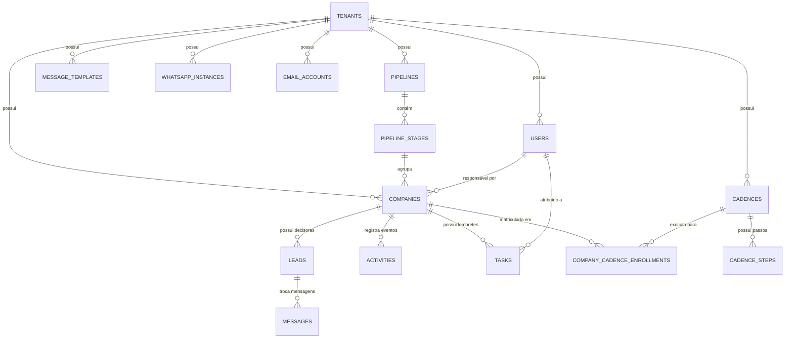

# Arquitetura de Dados & Entidades (SDR JARVIS)

Este documento descreve a modelagem conceitual do banco de dados relacional e a arquitetura das entidades que suportam os [Requisitos Funcionais](requisitos-funcionais.md) da plataforma.

---

## 🏗️ Diagrama Entidade-Relacionamento Conceitual

---

## 📦 Modelos e Tabelas Principais

### 1. `tenants`
* Isolamento lógico da organização/empresa cliente.
* Chave: `id` (BigInt PK).

### 2. `users`
* Usuários operadores (SDRs, Closers, Gestores de Vendas).
* Relacionamentos: `belongsTo(Tenant)`.

### 3. `companies` (Contas B2B)
* Representa a empresa-alvo prospectada.
* Campos principais:
  * `name`, `cnpj`, `domain`, `segment`, `employee_range`, `estimated_revenue`;
  * `status`: enum (`open`, `won`, `lost`, `unqualified`);
  * `meeting_at`: datetime da reunião confirmada;
  * `assigned_user_id`: chave estrangeira para `users`;
  * `pipeline_stage_id`: chave estrangeira para `pipeline_stages`.
* Relacionamentos:
  * `hasMany(Lead)`;
  * `hasMany(Activity)`;
  * `hasMany(Task)`;
  * `hasMany(CompanyCadenceEnrollment)`.

### 4. `leads` (Decisores / Contatos)
* Pessoa física com poder de decisão na empresa.
* Campos: `name`, `job_title`, `phone`, `email`, `linkedin_url`, `is_primary`.
* Relacionamentos: `belongsTo(Company)`.

### 5. `pipeline_stages`
* Etapas do funil de prospecção (ex: "Base Fria", "1º Toque", "Em Conversa", "Reunião Agendada").
* Campos: `name`, `position`, `color`, `tenant_id`.

### 6. `activities` (Timeline da Conta)
* Log de eventos e interações.
* Campos: `type` (`call`, `whatsapp`, `email`, `note`, `stage_change`, `meeting`), `title`, `description`, `metadata` (JSON), `user_id`, `company_id`.

### 7. `tasks` (Tarefas e Lembretes Operacionais)
* Ações manuais a serem executadas pelos SDRs.
* Campos: `title`, `type` (`call`, `whatsapp`, `email`, `research`, `meeting`), `priority` (`low`, `medium`, `high`, `urgent`), `due_date`, `status` (`pending`, `completed`), `completed_at`, `assigned_user_id`.

### 8. `cadences` e `cadence_steps` (Sequências Automatizadas)
* **`cadences`**: Régua de contato com `name`, `description`, `target_segment`, `color`.
* **`cadence_steps`**: Passos ordenados da cadência:
  * `step_number`: ordem na régua (1, 2, 3...);
  * `task_type`: canal (`whatsapp`, `email`, `call`, `linkedin`, `task`);
  * `delay_value`: valor do intervalo numérico;
  * `delay_unit`: grandeza de tempo (`seconds`, `minutes`, `hours`, `days`);
  * `title`, `instructions`, `template_content`.

### 9. `company_cadence_enrollments`
* Vínculo de execução da cadência para uma conta.
* Campos: `company_id`, `cadence_id`, `current_step`, `status` (`active`, `paused`, `completed`, `cancelled`), `enrolled_at`, `completed_at`.

### 10. `message_templates` (Biblioteca de Scripts)
* Modelos de abordagem e quebra de objeções pré-configurados.
* Campos: `title`, `category` (`approach`, `objection`, `followup`, `meeting`, `closing`), `channel` (`all`, `whatsapp`, `email`), `content`, `is_favorite`.

### 11. `whatsapp_instances`
* Gestão da sessão da Evolution API / Baileys.
* Campos: `instance_name`, `status`, `phone_number`, `qrcode`.

### 12. `email_accounts`
* Contas Google Workspace / Gmail conectadas via OAuth 2.0.
* Campos: `email`, `name`, `access_token`, `refresh_token`, `expires_at`.

---

## 🛡️ Camada de Segurança & Middlewares de Autorização

A plataforma possui uma arquitetura de defesa em profundidade para segregação de privilégios:

1. **`auth` (`Illuminate\Auth\Middleware\Authenticate`)**:
   * Protege todas as rotas privadas do CRM;
   * Redireciona usuários não autenticados para `/login`.

2. **`superadmin` (`App\Http\Middleware\EnsureSuperAdmin`)**:
   * Protege rotas globais de criação, edição, exclusão e alternância forçada de perfis de CRM (`/admin/tenants/*`);
   * Bloqueia qualquer usuário que não possua a flag `is_superadmin = true`.

3. **`can.manage.user` (`App\Http\Middleware\EnsureCanManageUser`)**:
   * Intercepta requisições de criação, edição e exclusão de colaboradores (`/admin/users/*`);
   * **Proteção de Contas de Administrador**: Impede estritamente que um Gestor Comercial altere dados, redefina senhas ou exclua usuários com papel de `admin` ou `superadmin`;
   * **Restrição de Escopo (Tenant Lock)**: Impede que o Gestor manipule usuários fora da sua base (`tenant_id`);
   * **Prevenção de Escalação de Privilégios**: Bloqueia tentativas de gestores criarem ou promoverem contas com `is_superadmin = true` ou `role = 'admin'`;
   * **Prevenção de Auto-Exclusão**: Impede que qualquer usuário exclua a própria conta logada.

