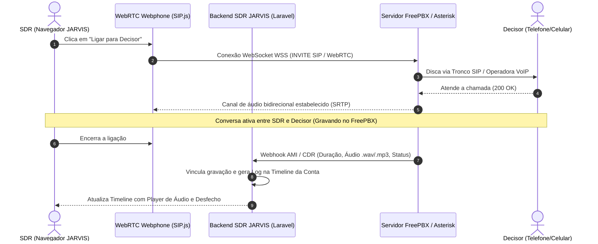

# Plano de Implementação: Integração FreePBX & Telefonia VoIP no SDR JARVIS

Este documento apresenta o plano arquitetural e o roteiro técnico detalhado para integrar o **[FreePBX](https://www.freepbx.org/)** (plataforma open-source baseada em Asterisk para PABX IP e telefonia empresarial) ao **SDR JARVIS**.

---

## 🎯 1. Objetivos da Integração

1. **Click-to-Call com 1 Clique**: O SDR clica no botão de telefone em qualquer card de lead e a ligação é disparada instantaneamente pelo navegador.
2. **Webphone WebRTC Embutido (Zero Instalação no PC)**: Ligação de alta fidelidade feita diretamente pela aba do SDR JARVIS utilizando microfone e fone de ouvido do computador, sem precisar instalar nenhum softphone externo.
3. **Gravação Automática de Chamadas**: O FreePBX grava o áudio das conversas e envia o link/arquivo diretamente para a timeline da conta no JARVIS.
4. **Log e Desfecho Automático (Call Outcomes)**: Duração da chamada, gravação e status (Conectou, Ocupado, Não Atendeu, Caixa Postal) são gravados automaticamente.
5. **Transcrição & Inteligência Artificial da Chamada**: Integração posterior com Whisper para transcrever a conversa e a IA do CRM gerar o resumo e mapear objeções automaticamente.
6. **Multi-Tenant VoIP**: Cada perfil de CRM ou SDR possui seu próprio ramal SIP e configurações de tronco dedicadas.

---

## 🏗️ 2. Arquitetura da Solução



---

## ⚙️ 3. Modalidades Técnicas de Operação

### Modalidade A: WebRTC Direto no Navegador (Recomendada)
* **Como funciona**: O FreePBX expõe uma porta WebSocket Segura (`wss://pabx.empresa.com:8089/ws`). A interface do SDR JARVIS utiliza a biblioteca **SIP.js** ou **JsSIP** para registrar o ramal do SDR como um cliente WebRTC nativo.
* **Vantagens**:
  * O SDR não precisa instalar absolutamente nada no computador;
  * Funciona no Chrome, Edge, Firefox e Safari;
  * Áudio em alta definição com codecs modernos (Opus);
  * Controle total de botões na interface (Mudo, Teclado DTMF, Transferência, Gravação).

### Modalidade B: Click-to-Call via AMI (Originate)
* **Como funciona**: O SDR utiliza um softphone tradicional instalado no Windows (ex: MicroSIP, Zoiper, Linphone ou aparelho físico). Ao clicar em "Ligar", o Laravel envia uma ordem via **AMI (Asterisk Manager Interface)** para tocar o ramal do SDR; quando ele atende, o FreePBX disca imediatamente para o telefone do lead e junta os dois.
* **Vantagens**:
  * Funciona com qualquer aparelho IP de mesa ou softphone legado já existente na empresa.

---

## 🗄️ 4. Modelagem de Dados no SDR JARVIS

### 4.1. Configuração do Servidor VoIP no Tenant (`tenants.settings`)
```json
{
  "voip": {
    "enabled": true,
    "provider": "freepbx",
    "server_host": "pabx.suaempresa.com.br",
    "webrtc_ws_url": "wss://pabx.suaempresa.com.br:8089/ws",
    "ami_host": "127.0.0.1",
    "ami_port": 5038,
    "ami_user": "jarvis_ami",
    "ami_secret": "senha_segura_ami",
    "recordings_base_url": "https://pabx.suaempresa.com.br/recordings/"
  }
}
```

### 4.2. Credenciais de Ramal por SDR (`users`)
* `sip_extension`: Número do ramal (ex: `1001`);
* `sip_secret`: Senha de autenticação do ramal PJSIP;
* `sip_webrtc_enabled`: Flag indicando se o ramal usa Webphone no navegador.

### 4.3. Registro da Chamada (`activities` & `call_logs`)
* `uniqueid`: Identificador global da chamada no Asterisk;
* `duration`: Tempo total da ligação em segundos;
* `billableseconds`: Tempo de conversação real após o atendimento;
* `disposition`: Status Asterisk (`ANSWERED`, `NO ANSWER`, `BUSY`, `FAILED`);
* `outcome`: Desfecho comercial mapeado no JARVIS (`connected`, `meeting_scheduled`, `gatekeeper`, `voicemail`);
* `recording_url`: URL do arquivo de áudio da chamada para reprodução;
* `transcription`: Transcrição de texto da conversa;
* `ai_summary`: Resumo executivo gerado por IA.

---

## 📋 5. Roteiro de Execução em Fases

### Fase 1: Preparação do FreePBX / Asterisk
1. Ativar suporte a WebRTC no Asterisk:
   * Habilitar módulo `res_http_websocket.so` e `res_pjsip_transport_websocket.so`.
   * Configurar certificado SSL válido (Let's Encrypt) no mini-servidor HTTP do Asterisk na porta `8089`.
2. Criar ramais PJSIP dedicados aos SDRs com as seguintes propriedades:
   * `transport`: `transport-wss`;
   * `dtls_verify`: `fingerprint`;
   * `dtls_cert_file`: certificado SSL;
   * `dtls_setup`: `actpass`;
   * `use_avpf`: `yes`;
   * `media_encryption`: `dtls`.
3. Criar usuário de integração AMI no FreePBX (`/etc/asterisk/manager_custom.conf`) com permissões de `originate`, `call`, `reporting`.

---

### Fase 2: Backend Laravel (SDR JARVIS)
1. Criar `App\Services\Voip\AsteriskAmiService.php`:
   * Conexão via socket TCP na porta `5038` com autenticação AMI;
   * Método `originateCall($fromExtension, $toNumber, $context = 'from-internal')`.
2. Criar Webhook para recepção de CDRs (Call Detail Records):
   * Rota `POST /api/webhooks/freepbx/cdr`;
   * Localiza a chamada pelo `uniqueid` ou número discado;
   * Atualiza a duração, associa o arquivo de gravação e atualiza o card do lead.
3. Rota para gerar token/credenciais de ramal para o SDR logado:
   * `GET /api/voip/credentials`: retorna a configuração do ramal do SDR autenticado de forma segura.

---

### Fase 3: Frontend Vue.js (Webphone Flutuante)
1. Instalar biblioteca de cliente WebRTC:
   ```bash
   npm install jssip
   ```
2. Criar componente `resources/js/Components/Voip/WebphoneWidget.vue`:
   * Floating Action Button (FAB) com ícone de telefone no canto inferior da tela;
   * Indicador visual de status do ramal (Verde: Registrado e Pronto, Vermelho: Desconectado);
   * Discador numérico com teclado DTMF;
   * Timer de conversação em tempo real (`00:00`);
   * Botões de ação rápida durante a chamada:
     * 🎙️ Mudo (Mute);
     * ⏸️ Em Espera (Hold);
     * 🛑 Encerrar Chamada;
     * 📅 Agendar Reunião Durante a Chamada.
3. Integrar botões **"Ligar"** em todos os contatos do Kanban:
   * Ao clicar no ícone de telefone do decisor, o Webphone disca automaticamente para o número formatado.
4. Player de áudio embutido na timeline do card da empresa para ouvir a gravação da ligação.

---

### Fase 4: Inteligência Artificial Pós-Chamada
1. Baixar o arquivo de áudio via job em segundo plano (`ProcessCallRecordingJob`);
2. Enviar para a API Whisper da OpenAI / Groq para transcrição ultrarrápida;
3. Submeter a transcrição ao agente de IA do CRM configurado para:
   * Detectar automaticamente se a chamada foi com o decisor ou secretária (Gatekeeper);
   * Extrair principais dores citadas;
   * Preencher o desfecho comercial (`call outcome`) de forma 100% autônoma.

---

## 💰 6. Vantagens de Custo do FreePBX

* **Software 100% Gratuito e Open-Source**: Sem cobrança de licença por ramal (diferente de Twilio ou Zoiper Pro).
* **Liberdade de Troncos VoIP**: A empresa pode contratar qualquer operadora de telefonia IP no Brasil (com tarifas de centavos por minuto para celular ou planos ilimitados).
* **Instalação Flexível**: Pode rodar em uma VM local na rede do escritório ou em um servidor cloud (ex: VPS de R$ 30 a R$ 50/mês na Hetzner, Contabo ou DigitalOcean).
