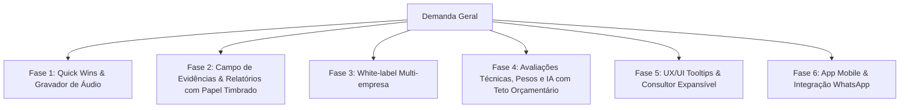

# Plano de Planejamento de Implementação — TalentiPro

Este plano organiza as novas demandas do TalentiPro em **módulos e fases lógicas**, priorizando a compatibilidade com a infraestrutura em produção (**Hospedagem Compartilhada cPanel / HostGator**), limites orçamentários de IA e robustez do sistema.

---

## 🗺️ Visão Geral dos Módulos



---

## 📋 Fase 1: Blindagem de Contingência do Gravador 1:1 (Áudio & Transcrição)
> **Objetivo:** Garantir que nunca haja perda de áudio ou do texto transcrito caso ocorra queda de internet, travamento do navegador ou erro na API de IA.

1. **Persistência de Áudio Local:**
   * O áudio já é fragmentado no **IndexedDB** (`talenti-gravador` v2).
   * **Melhoria:** Caso a chamada para a transcrição ou upload falhe, apresentar imediatamente banner fixo de contingência com:
     - Botão primário: **"Baixar Áudio (.webm)"**.
     - Botão secundário: **"Tentar Reenviar Transcrição"**.
2. **Salvamento Automático do Rascunho da Transcrição:**
   * Conforme o gestor digita ou revisa a transcrição editável, salvar a cada 3 segundos no `localStorage` (chave: `rascunho_transcricao_{reuniao_id}`).
   * Botão de contingência: **"Exportar Transcrição (.txt)"** direto do navegador do gestor antes mesmo de salvar no servidor.
   * Botão de restauração automática caso o navegador seja fechado acidentalmente.

---

## 📝 Fase 2: Campo de Evidências & Relatórios com Papel Timbrado e LGPD
> **Objetivo:** Adicionar campo de justificativa/evidências por critério, garantir visibilidade ao colaborador e padronizar impressão formal.

1. **Banco de Dados (Tabela `avaliacao_respostas`):**
   * Adicionar coluna `evidencia` (tipo `text`, anulável) em `avaliacao_respostas`.
2. **Interface de Avaliação do Líder (`avaliacoes/responder.blade.php`):**
   * Em cada competência/pergunta, adicionar textarea expansível opcional:
     - Rótulo: **"Evidências e Situações Observadas (Opcional)"**
     - Box de ajuda contextual destacado:
       > *"💡 Dica: É importante colocar evidências e situações reais que aconteceram. Isso vai te ajudar na hora de dar o feedback e justificar a nota atribuída."*
3. **Exibição no Relatório (Visão Gestor e Colaborador):**
   * No relatório de desempenho (`avaliacoes/relatorios` e modal de respostas), exibir a aba/cartão de evidências registradas (pontos positivos e situações relatadas).
   * Visível tanto para o líder quanto para o colaborador ao consultar seu relatório.
4. **Formatação de Impressão e PDF (Papel Timbrado + LGPD):**
   * Cabeçalho de impressão com layout de papel timbrado contendo o logotipo da empresa e marca d'água no centro do documento (CSS `@media print`).
   * Rodapé institucional obrigatório contendo:
     - Aviso de confidencialidade e conformidade com a LGPD (já existente na base).
     - Data, hora de emissão e identificador de autenticidade do documento.

---

## 🎨 Fase 3: Identidade Visual e White-label por Empresa Cliente
> **Objetivo:** Cada empresa parceira (ex: Fielmart, Intalenti, TalentiPro) terá sua identidade visual única, logotipo e cores aplicadas dinamicamente.

1. **Campos na Tabela `empresas` (Migration):**
   * `logo_url` (caminho da imagem do logotipo).
   * `marca_dagua_url` (imagem ou PNG transparente para fundo/impressão).
   * `cor_primaria` (ex: `#e67e22` degradé laranja para Fielmart, `#800020` bordô para Intalenti, `#6a4c7c` roxo padrão).
   * `cor_secundaria` / `cor_gradiente` (para composição de degradés elegantes).
   * `texto_marca_dagua` (opcional, para uso em texto).
2. **Interface Administrativa:**
   * Tela de Configurações da Empresa (`admin/empresas/{empresa}/edit` ou `configuracoes/empresa`) com preview em tempo real das cores e upload de logotipo.
3. **Injeção de CSS Dinâmico (CSS Variables):**
   * No `layouts/app.blade.php`, injetar variáveis CSS dinâmicas baseadas na empresa logada (`tenant` ativo):
     ```html
     <style>
       :root {
         --brand-primary: {{ auth()->user()->empresa->cor_primaria ?? '#6a4c7c' }};
         --brand-gradient: linear-gradient(135deg, {{ auth()->user()->empresa->cor_primaria ?? '#6a4c7c' }}, {{ auth()->user()->empresa->cor_secundaria ?? '#8b5cf6' }});
       }
     </style>
     ```
   * Logotipo dinâmico no topo/sidebar e marca d'água suave no fundo do painel.

---

## ⚖️ Fase 4: Avaliações Técnicas, Pesos, Mediação e IA Econômica
> **Objetivo:** Permitir avaliações de competências técnicas atreladas ao cargo, ponderação de pesos e sugestões por IA com controle rigoroso de custos.

1. **Competências Técnicas vs. Comportamentais:**
   * Campo `tipo` na tabela `competencias` (`comportamental` ou `tecnica`).
   * Associação cargo-competência: vincular competências técnicas recomendadas a cada `cargo_id`.
2. **Escala de Proficiência com Legenda Descritiva:**
   * Escala de 0 a 5 com badges claros:
     * `0`: Não conhece / Nunca aplicou.
     * `1`: Básico / Necessita de supervisão constante.
     * `2`: Intermediário / Executa com autonomia parcial.
     * `3`: Proficiente / Executa tarefas com plena autonomia.
     * `4`: Avançado / Referência para a equipe e resolve problemas complexos.
     * `5`: Domina o conhecimento / Capaz de treinar outros e inovar.
3. **Ponderação de Pesos (Ex: 70% Técnico / 30% Comportamental):**
   * Na configuração do modelo/campanha da avaliação, permitir definir:
     - `peso_tecnico` (ex: 70)
     - `peso_comportamental` (ex: 30)
   * Cálculo automático da nota global ponderada.
4. **Mediação de Notas e Justificativa:**
   * No painel de mediação e relatórios, exibir:
     - Nota Autoavaliação | Nota Líder | **Nota Final Mediada (Editável)**
   * Campo obrigatório ao alterar nota: **"Justificativa da Mediação"** (explicando o alinhamento feito no 1:1).
5. **Geração de Sugestões de Perguntas por IA com Teto Orçamentário:**
   * **Restrição de Custo:** Limite estrito de R$ 600/mês.
   * **Estratégia Técnica:**
     - Utilizar **Google Gemini 2.5 Flash** (modelo de altíssima performance com custo de frações de centavos por milhão de tokens).
     - Implementar **Cache no Banco de Dados** por descrição de cargo (se 5 colaboradores têm o mesmo cargo, a IA é chamada apenas 1 vez).
     - Prompts compactos e respostas estritamente em JSON estruturado, gerando 3 a 5 perguntas técnicas recomendadas por cargo.
6. **Alimentação Direta do PDI Técnico:**
   * Habilidades técnicas com notas ≤ 2 entram automaticamente como sugestões prioritárias no Plano de Desenvolvimento Individual (PDI) técnico.

---

## 💡 Fase 5: Experiência do Usuário (Tooltips & UX) e Permissões do Consultor
1. **Tooltips Contextuais ("Nuvenzinhas de Consultoria"):**
   * Componente leve em Vanilla CSS/JS com ícones sutis (`fa-regular fa-circle-question`).
   * Ao passar o mouse ou tocar no mobile, abre balão explicativo orientando o preenchimento ideal para gestores e colaboradores.
2. **Responsividade Mobile:**
   * Limitação de caracteres de exibição em telas < 480px com expansão `Ver mais`.
   * Cards com scroll horizontal suave ou quebra empilhada para evitar quebra de layout.
3. **Arquitetura Pronta para Consultores (Escrita Futura):**
   * Preparar na tabela `empresa_user` ou na `empresas_consultoria` a flag `permite_edicao_consultor` (boolean).
   * Na `AvaliacaoPolicy`, manter a trava atual, bastando ativar essa flag por empresa quando o cliente conceder a permissão.

---

## 📱 Fase 6: Aplicação Móvel e Disparos WhatsApp
1. **PWA (Progressive Web App) como Fase I do Mobile:**
   * Como a aplicação já é 100% web responsiva, implementar um `manifest.json` e Service Worker para que os colaboradores instalem direto no celular como um app nativo (sem custo e sem burocracia de Google Play / Apple Store).
2. **Integração WhatsApp (Evolution API):**
   * Disparo automático do link mágico/direto via WhatsApp para o colaborador responder sua avaliação técnica ou comportamental em um clique no celular.
3. **App Nativo Futuro:**
   * Criação de casca WebView / Capacitor ou Flutter consumindo as rotas de API existentes.
