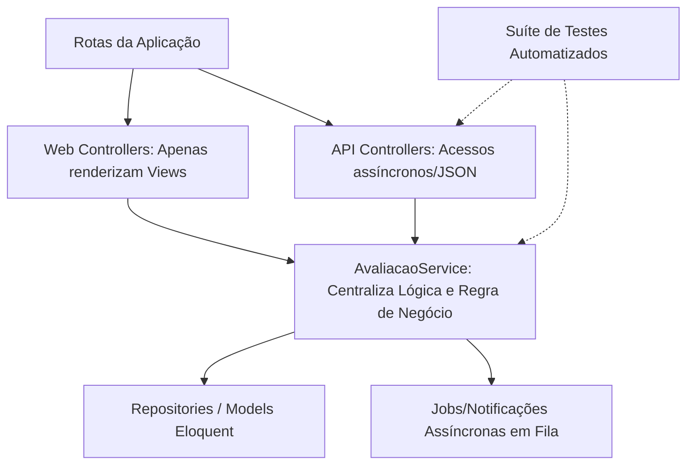

# README - Diretrizes para Refatoração, Código Limpo e Testes Automatizados
## Módulo de Avaliações (TalentiPro)

Este repositório contém o roteiro estruturado e o plano de ação profissional elaborado para guiar a refatoração, otimização das views, controladores, modelos e automação de testes do sistema de avaliações da **TalentiPro**. As diretrizes aqui propostas focam em manter o código limpo (*Clean Code*), seguro, performático e em eliminar testes manuais repetitivos (teste de mesa).

> [!IMPORTANT]
> **Nota de Integridade:** Este arquivo de documentação foi criado de forma isolada na raiz do projeto. **Nenhum arquivo de código executável (.php, .js, .blade.php) foi alterado** durante este mapeamento.

---

## 1. Como Enxugar e Otimizar o Código do Projeto

### A. Controllers "Magros"
Atualmente, [AvaliacaoWebController.php](app/Http/Controllers/Web/AvaliacaoWebController.php) (761 linhas) acumula muita lógica de negócio e validações em linha.
*   **Route Model Binding (Vinculação de Rotas):** Injetar modelos diretamente nos parâmetros dos métodos do controller (ex: `public function edit(Avaliacao $avaliacao)`) em vez de rodar manualmente `Avaliacao::findOrFail($id)` em cada método. O Laravel resolve e valida o registro automaticamente.
*   **Form Requests (Classes de Validação):** Criar classes de validação específicas (ex: `StoreAvaliacaoRequest`) e retirar as dezenas de linhas de `$request->validate([...])` de dentro dos controllers. O Laravel intercepta inputs inválidos automaticamente antes de entrar no fluxo principal.

### B. Models Organizados (SRP)
Evitar que as regras de consulta de dados fiquem expostas dentro do controlador.
*   **Query Scopes (Escopos de Consulta):** Mover queries longas de filtro (como as datas e tipos em `minhas_avaliacoes`) para métodos do Model (ex: `scopePessoaisAtivas()`). O controlador passa a chamar apenas uma linha legível: `AvaliacaoParticipante::pessoaisAtivas(auth()->id())->get()`.
*   **Accessors e Mutators:** Centralizar todas as conversões de formatação de valores e datas nos próprios modelos, evitando redundâncias em múltiplos locais.

### C. Padronização e Limpeza de APIs
*   **Eloquent API Resources:** Evitar a montagem manual de arrays de retorno em JSON no controller (como feito na consolidação de relatórios). Criar classes de Resource (ex: `RelatorioResource`) que padronizam a formatação e a exposição dos dados.
*   **Trait de Responses:** Implementar respostas JSON genéricas herdadas pelo controlador base (`respondSuccess()`, `respondError()`) para manter o código seco e livre de repetições.

### D. Otimização no Processamento de Dados (Backend)
*   **Filas Assíncronas (Laravel Queues):** O disparo de dezenas de notificações em lote (`Notificacao::create()`) na gravação de avaliações deve ser executado em segundo plano. Mover essa lógica de loop pesado para um **Job Assíncrono** impede lentidão perceptível no navegador ao salvar o formulário.
*   **Transações de Banco de Dados (`DB::transaction`):** Envolver a gravação em tabelas múltiplas em uma transação garante consistência total (se a gravação das competências ou participantes falhar, a transação reverte tudo e impede registros corrompidos na base).
*   **Cache de Relatórios:** Utilizar o sistema de cache do Laravel (`Cache::remember()`) por tempos predeterminados para reter os dados pesados calculados dos relatórios por Cargo/Setor, poupando consultas pesadas ao banco MySQL a cada clique.
*   **Uso de Selects Restritos:** Evitar carregar objetos inteiros na memória (`User::all()`). Trazer apenas as colunas úteis para os selects no HTML (ex: `User::select('id', 'name')->get()`), diminuindo de forma relevante a alocação de memória RAM do PHP.

---

## 2. Otimização e Limpeza de Views Blade

As views atuais contêm marcações enormes com HTML, CSS, Modais e JS misturados, o que dificulta o reaproveitamento de código e a manutenção.

### A. Substituição de Manipulação de DOM por Alpine.js
Em vez de usar JavaScript puro verboso para construir elementos na tela (como criar tags/chips para avaliados na unha usando `document.createElement`), recomenda-se usar o **Alpine.js** (um framework reativo declarativo leve que roda no próprio HTML).
*   **Como funciona:** Você declara o estado da lista no próprio HTML usando diretivas como `x-data` e realiza loops com `x-for`.
*   **Resultado:** O arquivo de visualização Blade reduz de tamanho em até 60% e a leitura fica muito mais limpa e intuitiva.

### B. Divisão em Componentes e Partials
Em vez de declarar modais inteiros dentro do mesmo arquivo de visualização, as views principais devem fragmentar modais e tabelas complexas em arquivos de "partials":
1. Criar a pasta `resources/views/avaliacoes/partials/`
2. Mover blocos específicos para arquivos menores:
   * `resources/views/avaliacoes/partials/modal-confirmacao.blade.php`
   * `resources/views/avaliacoes/partials/modal-solicitacao.blade.php`
   * `resources/views/avaliacoes/partials/tabela-perguntas.blade.php`
3. Incluir esses blocos no arquivo principal com chamadas limpas:
   ```php
   @include('avaliacoes.partials.modal-confirmacao')
   @include('avaliacoes.partials.modal-solicitacao')
   ```

---

## 3. Substituição de "Testes de Mesa" (Manuais) por Testes Automatizados

Fazer testes manuais abrindo abas anônimas para logar como gestor, preencher formulários, checar se a nota salvou no banco, logar como colaborador e depois olhar o phpMyAdmin consome muitas horas produtivas e não garante que o sistema continuará funcionando no próximo deploy.

O Laravel possui suporte nativo para **Feature Tests** que rodam o fluxo inteiro de forma simulada no banco de dados temporário em milissegundos.

### A. Criando Testes de Integração (Feature Tests)
Podemos programar um teste automatizado na pasta `tests/Feature/AvaliacaoTest.php` para simular as requisições de ponta a ponta:

```php
namespace Tests\Feature;

use Tests\TestCase;
use App\Models\User;
use Illuminate\Foundation\Testing\RefreshDatabase;

class AvaliacaoTest extends TestCase
{
    use RefreshDatabase; // Limpa o banco de teste antes de cada execução

    public function test_fluxo_completo_de_criacao_e_resposta_de_avaliacao()
    {
        // 1. Criar dados de teste (Factories)
        $master = User::factory()->create(['perfil_acesso' => 'master']);
        $avaliado = User::factory()->create(['perfil_acesso' => 'colaborador']);
        $gestor = User::factory()->create(['perfil_acesso' => 'gestor']);

        // 2. Fazer login como Master
        $this->actingAs($master);

        // 3. Simular a requisição POST de criação da avaliação
        $response = $this->post(route('avaliacoes.store'), [
            'titulo' => 'Avaliação Semestral da Equipe',
            'data_inicio' => now()->toDateString(),
            'data_fim' => now()->addDays(10)->toDateString(),
            'forma_avaliacao' => 'nota_1_10',
            'avaliados' => [$avaliado->id],
            'gestores' => [$gestor->id],
        ]);

        $response->assertRedirect(route('avaliacoes.index'));
        
        // 4. Verificar se salvou corretamente no banco de dados
        $this->assertDatabaseHas('avaliacoes', ['titulo' => 'Avaliação Semestral da Equipe']);
        $this->assertDatabaseHas('avaliacao_participantes', [
            'avaliado_id' => $avaliado->id,
            'avaliador_id' => $gestor->id,
            'tipo' => 'gestor',
            'status' => 'pendente'
        ]);

        // 5. Simular o Gestor respondendo a avaliação
        $participante = \App\Models\AvaliacaoParticipante::where('tipo', 'gestor')->first();
        
        $this->actingAs($gestor);
        $responseResposta = $this->post(route('avaliacoes.responder'), [
            'participante_id' => $participante->id,
            'notas' => [ 1 => 8.5 ],
            'observacao_avaliado' => 'Demonstrou dedicação.'
        ]);

        $responseResposta->assertJson(['success' => true]);
        
        // 6. Verificar se a avaliação foi concluída no banco
        $this->assertDatabaseHas('avaliacao_participantes', [
            'id' => $participante->id,
            'status' => 'realizada'
        ]);
    }
}
```
*Ao rodar o comando `php artisan test`, toda a simulação acima é concluída em **menos de 2 segundos**.*

---

## 4. Nova Arquitetura de Fluxo Proposta



---

## 5. Plano de Ação Passo a Passo

### Fase 1: Camada de Negócio & Otimização do Banco (Back-end)
1. Criar `app/Services/AvaliacaoService.php` para encapsular a lógica de persistência e amarração de participantes.
2. Adaptar o método `processarParticipantes` para obter todos os registros do banco em lote e processar em memória, eliminando queries em loops.
3. Utilizar o método `insert()` em massa do Eloquent Laravel para inserção de participantes.

### Fase 2: Segurança e Divisão de Endpoints
1. Criar `app/Http/Controllers/Api/AvaliacaoApiController.php` para abrigar todos os retornos JSON do sistema.
2. Criar o comando Artisan customizado `php artisan talentipro:fix-symlink` para tarefas de symlink e deletar de vez a rota `/fix-storage-link` exposta no arquivo [web.php](routes/web.php).

### Fase 3: Suíte de Testes Automatizados e Enums
1. Criar as factories para geração rápida de dados (`UserFactory`, `AvaliacaoFactory`, `AvaliacaoParticipanteFactory`).
2. Escrever os testes de integração simulando o fluxo de avaliações em `tests/Feature/AvaliacaoTest.php`.
3. Padronizar os tipos usando PHP Native Enums (ex: `App\Enums\TipoParticipante`).

### Fase 4: Otimização e Limpeza de Controllers, Models e Views
1. Implementar Query Scopes (`scopePessoaisAtivas()`) nos Models e desviar as validações do controller para classes Form Requests dedicadas.
2. Habilitar filas (Queues) para envio de notificações em segundo plano e cache para resultados de relatórios recorrentes.
3. Extrair os blocos de CSS e JS inline das views Blade para arquivos estáticos.
4. Separar modais e tabelas complexas em views parciais dentro de `resources/views/avaliacoes/partials/` e adotar o Alpine.js.
