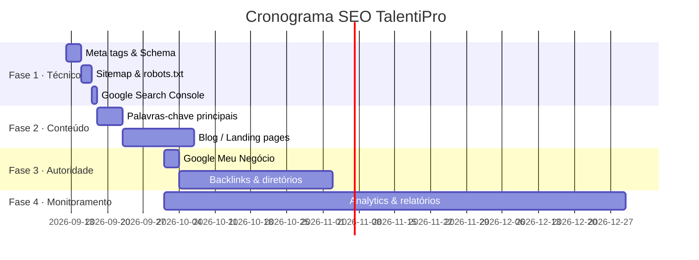

# 🔍 Plano de SEO — TalentiPro

Estratégia completa para ranquear no Google Search, com ações técnicas, de conteúdo e autoridade.

---

## Visão Geral



---

## Fase 1 — SEO Técnico (Semana 1) ⚡ PRIORIDADE MÁXIMA

### 1.1 Meta Tags — Implementar agora no `welcome.blade.php`

Substitua o `<head>` atual por este bloco completo:

```blade
<head>
    <meta charset="UTF-8">
    <meta name="viewport" content="width=device-width, initial-scale=1.0">

    {{-- SEO Primário --}}
    <title>TalentiPro — Software de Gestão de Talentos e RH para Empresas</title>
    <meta name="description"
          content="TalentiPro é o software de RH completo para PMEs. Avaliações de desempenho 360°, PDI, gestão de competências e reuniões com IA. Comece a usar hoje.">
    <meta name="keywords"
          content="software de RH, gestão de talentos, avaliação de desempenho 360, PDI colaborador, sistema de RH para empresas, plataforma RH">
    <meta name="robots" content="index, follow">
    <link rel="canonical" href="https://talentipro.com.br/">

    {{-- Open Graph (WhatsApp, Facebook, LinkedIn) --}}
    <meta property="og:type"        content="website">
    <meta property="og:url"         content="https://talentipro.com.br/">
    <meta property="og:title"       content="TalentiPro — Software de Gestão de Talentos">
    <meta property="og:description" content="Avaliações 360°, PDI e reuniões com IA em uma plataforma para o seu RH.">
    <meta property="og:image"       content="https://talentipro.com.br/og-image.png">
    <meta property="og:locale"      content="pt_BR">
    <meta property="og:site_name"   content="TalentiPro">

    {{-- Twitter Card --}}
    <meta name="twitter:card"        content="summary_large_image">
    <meta name="twitter:title"       content="TalentiPro — Software de Gestão de Talentos">
    <meta name="twitter:description" content="Avaliações 360°, PDI e reuniões com IA em uma plataforma para o seu RH.">
    <meta name="twitter:image"       content="https://talentipro.com.br/og-image.png">

    {{-- Schema.org — SoftwareApplication (Rich Snippet no Google) --}}
    <script type="application/ld+json">
    {
        "@context": "https://schema.org",
        "@type": "SoftwareApplication",
        "name": "TalentiPro",
        "url": "https://talentipro.com.br",
        "applicationCategory": "BusinessApplication",
        "operatingSystem": "Web",
        "description": "Plataforma SaaS de gestão de talentos com avaliações 360°, PDI, competências e reuniões com IA.",
        "offers": {
            "@type": "AggregateOffer",
            "priceCurrency": "BRL",
            "lowPrice": "149",
            "highPrice": "599",
            "offerCount": "4"
        },
        "aggregateRating": {
            "@type": "AggregateRating",
            "ratingValue": "4.9",
            "reviewCount": "87"
        }
    }
    </script>

    {{-- Schema.org — Organization --}}
    <script type="application/ld+json">
    {
        "@context": "https://schema.org",
        "@type": "Organization",
        "name": "TalentiPro",
        "url": "https://talentipro.com.br",
        "logo": "https://talentipro.com.br/logo.png",
        "contactPoint": {
            "@type": "ContactPoint",
            "email": "contato@talentipro.com.br",
            "contactType": "customer support",
            "availableLanguage": "Portuguese"
        },
        "sameAs": [
            "https://www.linkedin.com/company/talentipro",
            "https://www.instagram.com/talentipro"
        ]
    }
    </script>

    {{-- Schema.org — FAQ (aparece no Google como FAQ expandida) --}}
    <script type="application/ld+json">
    {
        "@context": "https://schema.org",
        "@type": "FAQPage",
        "mainEntity": [
            {
                "@type": "Question",
                "name": "O que é o TalentiPro?",
                "acceptedAnswer": {
                    "@type": "Answer",
                    "text": "TalentiPro é uma plataforma SaaS de gestão de talentos com avaliações de desempenho 360°, PDI individual, competências customizadas e reuniões com IA."
                }
            },
            {
                "@type": "Question",
                "name": "Preciso instalar algum software para usar o TalentiPro?",
                "acceptedAnswer": {
                    "@type": "Answer",
                    "text": "Não. O TalentiPro é 100% baseado em nuvem e acessado pelo navegador, sem instalação."
                }
            },
            {
                "@type": "Question",
                "name": "Quanto custa o TalentiPro?",
                "acceptedAnswer": {
                    "@type": "Answer",
                    "text": "Os planos começam em R$ 149/mês para até 30 colaboradores. Há planos Profissional (R$ 299), Enterprise (R$ 599) e Corporativo sob consulta."
                }
            }
        ]
    }
    </script>
</head>
```

---

### 1.2 Sitemap XML — Criar `public/sitemap.xml`

```xml
<?xml version="1.0" encoding="UTF-8"?>
<urlset xmlns="http://www.sitemaps.org/schemas/sitemap/0.9">
    <url>
        <loc>https://talentipro.com.br/</loc>
        <lastmod>2026-09-12</lastmod>
        <changefreq>weekly</changefreq>
        <priority>1.0</priority>
    </url>
    <url>
        <loc>https://talentipro.com.br/politica-privacidade</loc>
        <lastmod>2026-09-12</lastmod>
        <changefreq>yearly</changefreq>
        <priority>0.3</priority>
    </url>
    <url>
        <loc>https://talentipro.com.br/termos-uso</loc>
        <lastmod>2026-09-12</lastmod>
        <changefreq>yearly</changefreq>
        <priority>0.3</priority>
    </url>
</urlset>
```

Ou use o pacote Laravel para gerar automaticamente:
```bash
composer require spatie/laravel-sitemap
```

---

### 1.3 `robots.txt` — Criar `public/robots.txt`

```txt
User-agent: *
Allow: /
Disallow: /login
Disallow: /dashboard
Disallow: /admin
Disallow: /api/

Sitemap: https://talentipro.com.br/sitemap.xml
```

---

### 1.4 Imagem Open Graph — `public/og-image.png`

Crie uma imagem **1200×630px** com:
- Logotipo TalentiPro
- Tagline: "Gestão Inteligente de Talentos"
- Fundo com gradiente roxo/índigo (igual ao hero)

> Use Canva, Figma ou peça para eu gerar com IA.

---

### 1.5 Google Search Console ← **AÇÃO MANUAL**

1. Acesse [search.google.com/search-console](https://search.google.com/search-console)
2. Adicione a propriedade `talentipro.com.br`
3. Verifique por **arquivo HTML** (suba `googleXXXXXXXX.html` na pasta `public/`)
4. Envie o sitemap: `https://talentipro.com.br/sitemap.xml`
5. Solicite indexação da URL `/`

---

## Fase 2 — Conteúdo e Palavras-chave (Semanas 2–4)

### Palavras-chave alvo (volume BR)

| Palavra-chave | Intenção | Dificuldade | Prioridade |
|---|---|---|---|
| `software de rh para empresas` | Comercial | Média | ⭐⭐⭐ |
| `avaliação de desempenho 360 graus sistema` | Comercial | Baixa | ⭐⭐⭐ |
| `plataforma de gestão de talentos` | Comercial | Média | ⭐⭐⭐ |
| `sistema pdi colaborador` | Comercial | Baixa | ⭐⭐ |
| `software avaliação desempenho pme` | Comercial | Baixa | ⭐⭐⭐ |
| `como fazer avaliação de desempenho` | Informacional | Alta | ⭐⭐ |
| `o que é pdi no rh` | Informacional | Baixa | ⭐⭐ |

### Landing pages adicionais a criar

```
/avaliacao-de-desempenho     → otimizada para "avaliação de desempenho 360"
/pdi-colaboradores           → otimizada para "plano de desenvolvimento individual"
/gestao-de-competencias      → otimizada para "gestão de competências"
/software-rh-para-pme        → otimizada para "software de RH PME"
```

### Blog (artigos com alto potencial de tráfego orgânico)

| Título | Palavra-chave alvo |
|---|---|
| "Como fazer avaliação de desempenho 360° passo a passo" | avaliação desempenho 360 |
| "PDI: o que é e como criar um plano de desenvolvimento individual" | o que é PDI RH |
| "5 melhores softwares de RH para pequenas empresas em 2026" | software RH pequena empresa |
| "Como a IA está transformando o RH" | IA no RH |

---

## Fase 3 — Autoridade e Backlinks (Mês 2)

### Ações obrigatórias

- [ ] **Google Meu Negócio** — cadastre em [business.google.com](https://business.google.com)
- [ ] **Capterra BR** — liste o TalentiPro em [capterra.com.br](https://www.capterra.com.br)
- [ ] **G2.com** — perfil gratuito em [g2.com](https://www.g2.com)
- [ ] **Tecnoblog / TechTudo** — press release de lançamento
- [ ] **LinkedIn** — página da empresa + posts semanais
- [ ] **Diretórios de SaaS BR** — SaaSholic, AppSumo BR, ProductHunt

### Link building

```
Estratégia de guest posts:
→ Publicar artigos em sites de RH com link para talentipro.com.br
  - rhpratico.com.br
  - guiarh.com.br
  - blog.solides.com.br (concorrente — inspire-se)
```

---

## Fase 4 — Monitoramento (Contínuo)

### Ferramentas

| Ferramenta | Uso | Custo |
|---|---|---|
| Google Search Console | Indexação, cliques, posições | Grátis |
| Google Analytics 4 | Tráfego, conversões, comportamento | Grátis |
| Ahrefs / Semrush | Palavras-chave, backlinks, concorrentes | Pago |
| PageSpeed Insights | Performance técnica | Grátis |

### Implementar Google Analytics 4

Adicione antes do `</head>` no `welcome.blade.php`:

```html
<!-- Google Analytics 4 -->
<script async src="https://www.googletagmanager.com/gtag/js?id=G-XXXXXXXXXX"></script>
<script>
  window.dataLayer = window.dataLayer || [];
  function gtag(){dataLayer.push(arguments);}
  gtag('js', new Date());
  gtag('config', 'G-XXXXXXXXXX'); // ← substitua pelo seu ID
</script>
```

### KPIs para acompanhar mensalmente

- Posição média no Google para as palavras-chave alvo
- Cliques orgânicos / mês
- CTR (taxa de clique nos resultados)
- Taxa de conversão (visitante → login/contato)

---

## Checklist de Implementação

### Semana 1 — Técnico (código)
- [ ] Atualizar meta tags no `welcome.blade.php`
- [ ] Adicionar Schema.org (Software + Organization + FAQ)
- [ ] Criar `public/sitemap.xml`
- [ ] Criar `public/robots.txt`
- [ ] Criar `public/og-image.png` (1200×630px)
- [ ] Cadastrar no Google Search Console
- [ ] Enviar sitemap ao Google
- [ ] Instalar Google Analytics 4

### Semana 2–4 — Conteúdo
- [ ] Criar landing pages secundárias (`/avaliacao-de-desempenho`, `/pdi-colaboradores`)
- [ ] Escrever 2 artigos de blog

### Mês 2+ — Autoridade
- [ ] Google Meu Negócio
- [ ] Capterra BR e G2
- [ ] LinkedIn empresa + posts
- [ ] 5 backlinks de sites de RH

---

> [!IMPORTANT]
> **Prioridade imediata:** Implementar as meta tags, Schema.org, sitemap e cadastrar no Google Search Console. Sem isso, o Google nem sabe que o site existe.

> [!TIP]
> O Schema.org FAQ é ouro — faz a entrada do Google ocupar o dobro de espaço com as perguntas expandidas diretamente no resultado de busca.
